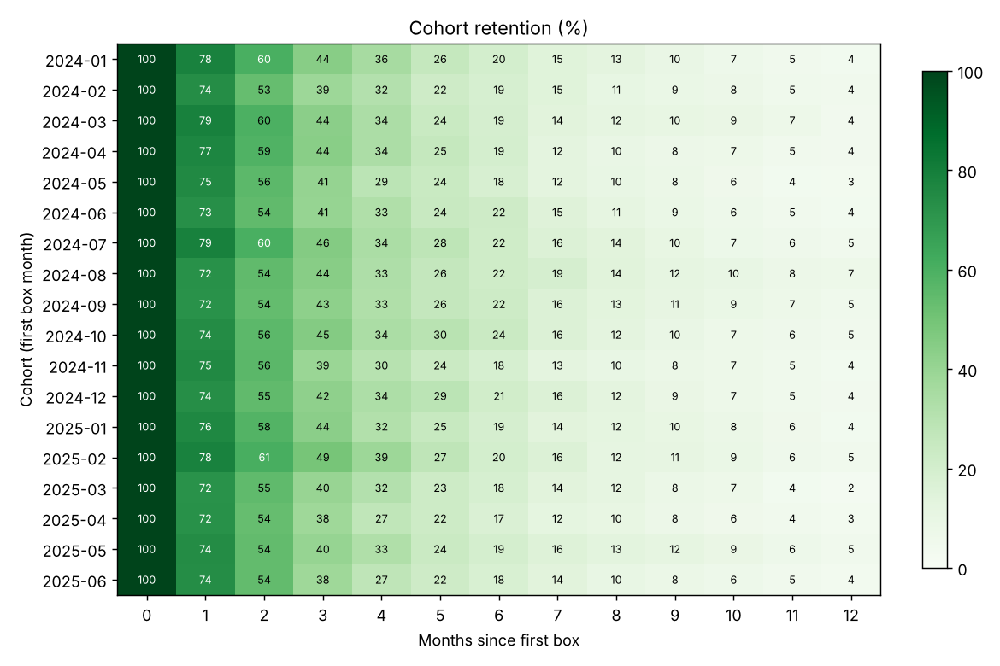
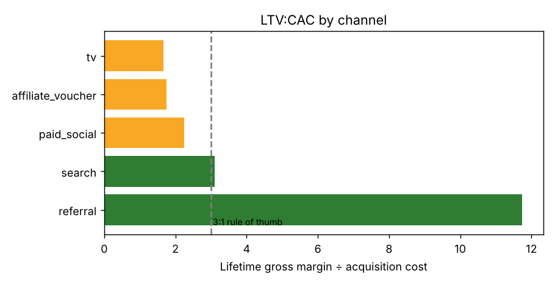
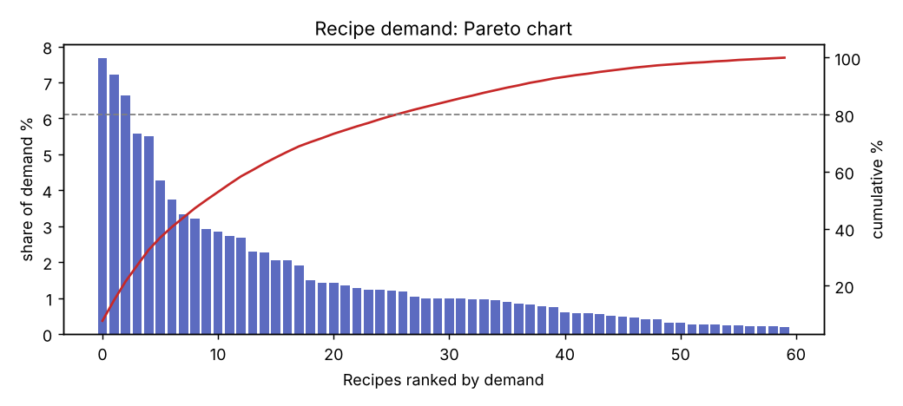
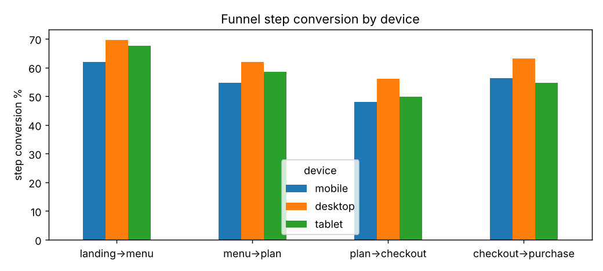
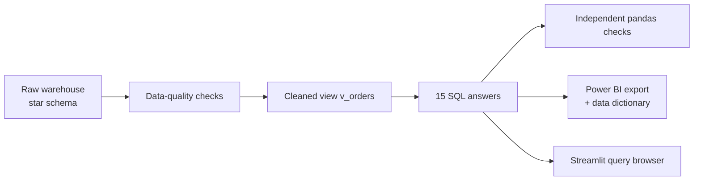

# SQL Analytics Case Study: 
**[Walkthrough notebook](notebooks/walkthrough.ipynb)** · **[Power BI export](powerbi/README.md)** · **[Methods](docs/methods.md)** · **[System card](docs/system_card.md)** · **[Data](data/README.md)**

## Executive summary

- **Business question.** Harvest Box's leadership wants to know where growth, retention and channel spend are working, and why customers cancel.
- **Answer.** Only **~40% of a cohort is still ordering in month 3**; **referral** customers return **11.7× their acquisition cost** while TV and voucher channels sit at 1.7×; **price (31%) and time to cook (20%)** drive cancellations; the new checkout lifted conversion **+8.7% (significant)**.
- **Recommendation.** Move budget from vouchers and TV to referrals, launch a cheaper quick-recipe plan, roll out checkout variant B, and fix the mobile funnel.
- **Tools.** SQL (CTEs, window functions, cohorts, funnels, A/B test, indexing) · SQLite · pandas cross-checks · Power BI star schema


**Problem.** **Harvest Box** is a (fictional) UK meal-kit subscription company. The leadership team has asked for answers to 15 questions: data quality, growth, retention, channel profitability, customer segments, churn reasons, the sign-up funnel and an A/B test. Every answer is a **single, readable SQL query** in [`sql/`](sql), checked against an independent pandas calculation in the test suite.

**Dataset.** Synthetic SQLite warehouse: 12,000 customers · 121,000 deliveries · 424,000 recipe lines · 60,000 web events · 30 months, in a star schema (`dim_*` / `fact_*`). Generated with a fixed seed, including planted data-quality problems; see [data/README.md](data/README.md).

**Approach.** Check data quality first, build one cleaned view (`v_orders`) that every query reads, answer each question in one SQL file, verify every answer against independent pandas code, then hand the result to BI as a documented **Power BI star schema**.

## Results: key findings

| # | Question | Answer |
|---|---|---|
| 1 | Can we trust the data? | No, not as delivered: **15 duplicate orders, 8 with missing revenue, 5 for unknown customers.** All later queries use a cleaned view. |
| 3 | Is revenue growing? | Yes. Revenue roughly **6× from Jan 2024 to Dec 2024**, with a winter peak and a summer dip. |
| 4 | Do customers stay? | Only **~40% of a cohort is still ordering in month 3** and **~20% in month 6**. Retention is the business's biggest lever. |
| 5–6 | Which channels are worth it? | **Referral** customers retain best (31% at month 6) with LTV:CAC of **11.7**. **TV** and **affiliate vouchers** are below the 3:1 rule of thumb (1.7 each). Voucher customers churn fastest (4% at month 6). |
| 7 | Who are the best customers? | **"Champions" are 18% of customers and 39% of revenue.** The "At risk" segment (12% of customers, 18% of revenue) is the retention target. |
| 8 | Why do people cancel? | **Price (~31%)** and **lack of time to cook (~20%)** dominate at every tenure, which points to a cheaper or quicker-recipe plan. |
| 9 | Do a few recipes drive demand? | Yes: **the top 10 of 60 recipes are 50% of all orders.** |
| 10 | Where does the funnel leak? | Mobile converts at **9.2%** against desktop's **15.3%**, losing ground at every step. |
| 11 | Did the new checkout work? | **Yes.** Variant B lifted checkout→purchase from 56.5% to 61.4% (**+8.7%, z = 3.53, significant at 5%**). |
| 15 | Can the dashboard be faster? | A covering index changes a full **SCAN** into an index **SEARCH**: **5.5 ms → 0.65 ms (8×)**. |

<p float="left">
  
  
</p>
<p float="left">
  
  
</p>

## SQL techniques shown

| Technique | Where |
|---|---|
| CTEs, multi-step logic | all files |
| Window functions: `LAG`, `ROW_NUMBER`, `RANK`, `NTILE`, `FIRST_VALUE`, `CUME_DIST` | 02, 03, 04, 07, 09, 13 |
| Running totals (`SUM() OVER (ORDER BY … ROWS UNBOUNDED PRECEDING)`) | 09, 12 |
| Percent of total (`SUM(COUNT(*)) OVER (PARTITION BY …)`) | 07, 08 |
| Cohort analysis and date arithmetic | 04, 05 |
| Conditional aggregation and `FILTER` | 05, 10, 11 |
| Gaps-and-islands sessionization | 12 |
| Statistical testing in SQL (two-proportion z-test) | 11 |
| Anti-joins and data-quality checks | 01 |
| Views for a single source of truth | 02 |
| Joining facts at different grains safely | 06 |
| Index design and `EXPLAIN QUERY PLAN` | 15 |

## Power BI export

`python -m harvest.export_powerbi` turns the warehouse into **Power BI-ready star-schema CSVs** in [`powerbi/`](powerbi): five dimensions (including a proper date table with ISO weeks, UK seasons and UK fiscal years) and five fact tables, with consistent integer keys, ISO dates and no index columns. Cohort month, months since first box, gross margin, RFM segment and funnel step flags are pre-computed with the same rules as the SQL answers.

[powerbi/README.md](powerbi/README.md) covers loading in Power BI Desktop (Text/CSV or a re-pointable folder parameter), the 12 relationships to create (all many-to-one, single direction, plus 2 optional inactive ones), 30+ DAX measures (revenue, MoM/YoY, LTV:CAC, cohort retention, Pareto, funnel, A/B z-score) and a 3-page dashboard layout tied to the findings above. [powerbi/data_dictionary.md](powerbi/data_dictionary.md) documents every column. The CSVs are committed (largest 12.8 MB), so no Python is needed to build the dashboard. The test suite checks the export (row counts match the database, unique keys, no orphan foreign keys) and recomputes LTV:CAC from the CSVs to match the SQL.

## Demo

```bash
pip install -r requirements.txt
PYTHONPATH=src python -m harvest.build_db        # builds data/harvest.db (~30 s)
PYTHONPATH=src python -m harvest.run             # runs all 15 queries → results/*.csv + charts
PYTHONPATH=src python -m harvest.export_powerbi  # star-schema CSVs → powerbi/ (~10 s)
PYTHONPATH=src streamlit run app.py              # pick a question, read the SQL, see the answer
```

The Streamlit app shows each question's SQL next to its result and chart, has a read-only box for your own `SELECT` queries, and renders the Power BI guide.

The queries are plain SQLite SQL and port to PostgreSQL, BigQuery or Snowflake with minor date-function changes. You can also open `data/harvest.db` in DBeaver or DB Browser for SQLite and run any file from `sql/` directly (run `02_clean_orders_view.sql` first).

## Architecture



## Repository structure

```
├── app.py                     Streamlit SQL explorer
├── sql/                       15 analysis queries, each opening with the business question it answers
│   └── powerbi/               queries that build the Power BI fact and dimension tables
├── src/harvest/
│   ├── build_db.py            synthetic warehouse generator (with planted data-quality issues)
│   ├── run.py                 runs every query, saves results/ and charts
│   └── export_powerbi.py      star-schema CSV export + date dimension + data dictionary
├── powerbi/                   10 CSVs, README (load, relationships, DAX, layout), data_dictionary.md
├── results/                   query outputs as CSV
├── reports/figures/           charts
├── notebooks/walkthrough.ipynb   step-by-step analysis (executed)
├── data/README.md             how the data is generated, schema; harvest.db is git-ignored
├── models/README.md           why there is no model (SQL project)
├── docs/                      methods.md, system_card.md
└── tests/                     pandas cross-checks for every query + Power BI export checks
```

## Tests

```bash
pytest -q    # 22 tests: 14 check SQL answers against pandas, 8 check the Power BI export
```

## Data governance
- **Data quality before conclusions.** Duplicates, missing revenue and orphan orders are found and removed in one documented view before any number is reported; the Power BI export applies the same rules and is tested against the database.
- **Bias and fairness.** Segments and channel results are associations, not causes. `age_band` and `region` are descriptive only: if RFM segments drive offers, check that discounts and win-back campaigns don't systematically exclude age groups or regions.
- **Explainability.** Every number traces to one readable SQL file and a pandas cross-check; DAX measures in the Power BI guide mirror the SQL definitions, and the data dictionary documents every column.
- **Privacy (UK GDPR).** The data is synthetic. In a real warehouse customers and web events are personal data: the analysis needs only pseudonymous IDs (no names, emails or addresses), web visitors are not linked to customers, and Power BI access should be role-restricted with a retention policy.
- **Limitations.** Findings come from a generator with planted patterns, LTV is realised margin to date (recent cohorts look worse), costs use a flat £6.50 per box, and only the A/B test supports a causal claim. See the [system card](docs/system_card.md).
- **Human oversight.** Results inform decisions (for example, reviewing TV and voucher spend); they shouldn't trigger automatic budget cuts or customer-level actions without review.
